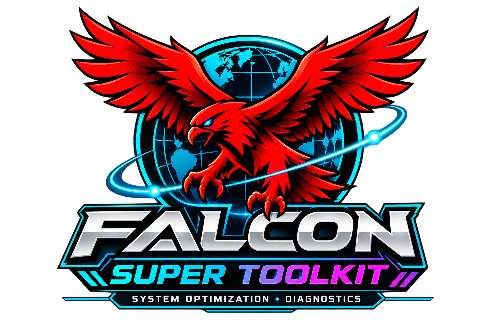
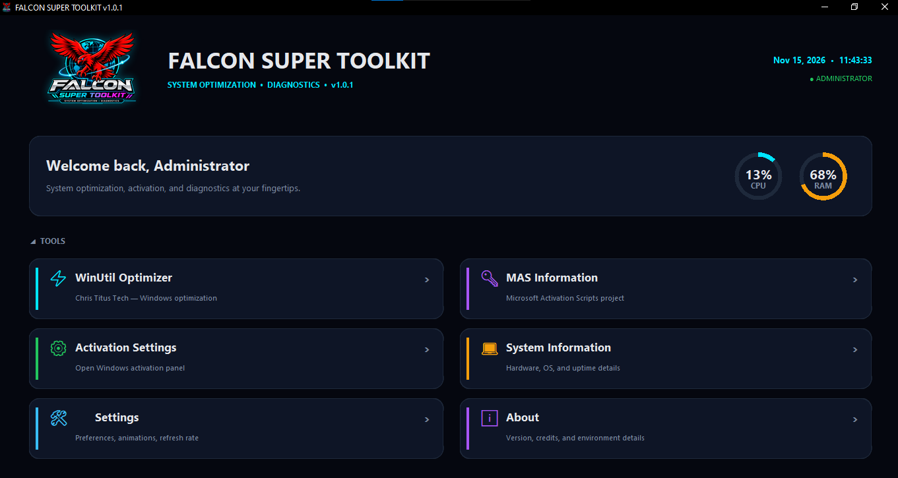
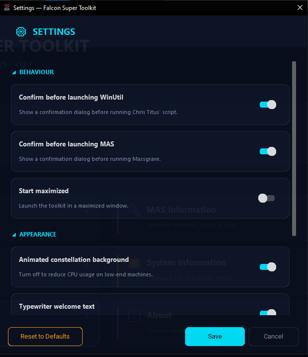
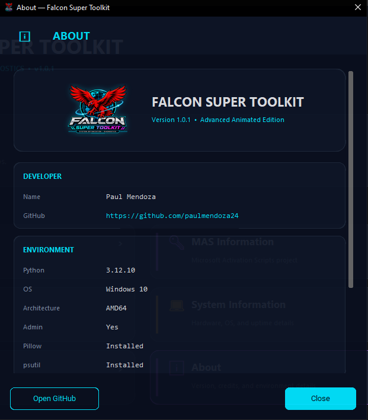

# 🦅 FALCON SUPER TOOLKIT

### Version 1.0.1 — Advanced Animated Edition

**System Optimization, Activation, and Diagnostics at Your Fingertips.**

<p align="center">
  
</p>

<p align="center">
  
  
  
  
</p>

---

## 📖 About

**Falcon Super Toolkit** is a modern, heavily animated, dark-themed Windows utility application designed to bring essential system management tools together in one convenient interface.

Developed using Python and CustomTkinter, it combines a sleek graphical user interface with interactive animations, real-time system monitoring, and quick access to popular third-party Windows utilities.

The application features a dynamic constellation background, animated CPU and RAM monitoring gauges, a professional startup splash screen, and customizable settings.

## ✨ Features

| Feature | Description |
|---|---|
| 🌌 Animated Constellation Background | Interactive particle network with dynamic movement and visual effects. |
| 📊 Live System Monitoring | Real-time CPU and RAM usage displayed through animated circular gauges. |
| 🚀 Animated Splash Screen | Professional startup animation with a progress bar. |
| ⚡ WinUtil Integration | Quick access to Chris Titus Tech's Windows Utility. |
| 🔑 MAS Integration | Access to Microsoft Activation Scripts (MAS). |
| 💻 System Information | View hardware specifications, operating system information, and system uptime. |
| 🛠️ Custom Settings | Configure application preferences with JSON-based storage. |
| ℹ️ About Screen | Displays application information and developer details. |
| 🔒 Administrator Privileges | Requests elevated permissions for supported administrative operations. |
| 🎨 Modern Interface | Dark-themed interface with responsive layouts and hover animations. |

## 📸 Screenshots

Add your actual application screenshots to the repository and update the image paths below.

| Dashboard | Settings | About |
|---|---|---|
|  |  |  |

## 🚀 Installation

### Option 1: Download the Latest Installer (Recommended)

<kbd>Version 1.0.1</kbd>

Download the official Falcon Super Toolkit installer:

<p align="center">
  <a href="https://download1324.mediafire.com/g2hbbxlobjkgL9_zPleeExfWX26quKK95QKDU-mNheof3dkANShI1-vtDkpF2DtLVyjN4We-T2fI4TnRE0weAf-RtEThU6RHA5dPUyDNACht08ECZNIy0lA1tolZ-oWfn4uZ5qe9q6iUNKyNpcP3DC39OlKz1aJha-GMqQHkAeXHAg/gvgpj7ocksuvl91/FalconSuperToolkit_Setup_v1.0.1.exe">
    
  </a>
</p>

**Installer:** `FalconSuperToolkit_Setup_v1.0.1.exe`

**Installation Steps:**

1. Click the Download button above.
2. Download `FalconSuperToolkit_Setup_v1.0.1.exe`.
3. Run the installer.
4. Follow the installation wizard.
5. Launch Falcon Super Toolkit from your Desktop or Start Menu.

**Note:** Administrator permission may be required for certain system management features.

### Windows SmartScreen Notice

Windows Defender SmartScreen may display a warning if the executable is not signed with a trusted code-signing certificate.

Only proceed if you trust the source and have reviewed the application.

## 🛠️ Build from Source

### Requirements

- Windows 10 or Windows 11 (64-bit)
- Python 3.10 or newer
- pip package manager

### 1. Clone the Repository

```bash
git clone https://github.com/paulmendoza24/yFalconSuperToolkit.git
cd FalconSuperToolkit
```

### 2. Install Dependencies

```bash
pip install -r requirements.txt
```

### 3. Prepare Assets

Make sure the required assets are available:

```text
assets/
├── falcon_logo.png
└── falcon_logo.ico
```

- `falcon_logo.png` — Application logo and splash screen.
- `falcon_logo.ico` — Windows application icon.

### 4. Run the Application

```bash
python falcon_toolkit.py
```

## 📦 Build Executable

You can package the application into a standalone Windows executable using PyInstaller.

Install PyInstaller:

```bash
pip install pyinstaller
```

Example build command:

```bash
pyinstaller --noconfirm --clean --windowed --onefile ^
  --name FalconSuperToolkit ^
  --icon=assets/falcon_logo.ico ^
  --add-data "assets;assets" ^
  falcon_toolkit.py
```

The generated executable will be available inside:

```text
dist/FalconSuperToolkit.exe
```

**Build Notes:**
- Include all required application assets.
- Configure the correct asset paths for PyInstaller's bundled environment.
- Include the appropriate Windows version information if needed.
- Test the packaged executable before distributing it.
- Use a Windows application manifest if administrator elevation is required.

## 📂 Project Structure

```text
FalconSuperToolkit/
│
├── falcon_toolkit.py
├── README.md
│
├── assets/
│   ├── falcon_logo.png
│   └── falcon_logo.ico
│
├── screenshots/
│   ├── dashboard.png
│   ├── settings.png
│   └── about.png
│
└── FalconSuperToolkit.exe
```

## 🔗 Third-Party Integrations

Falcon Super Toolkit provides access to external projects and utilities.

### ⚡ WinUtil

**Chris Titus Tech's Windows Utility**

A third-party Windows management and optimization utility.

Repository: https://github.com/ChrisTitusTech/winutil

### 🔑 Microsoft Activation Scripts (MAS)

A third-party open-source project providing Windows and Office activation-related scripts.

Repository: https://github.com/massgravel/Microsoft-Activation-Scripts

**Important:** These integrations are maintained by their respective developers and are not owned or developed by Falcon Super Toolkit.

Always review external scripts and understand their functionality before running them.

## ⚠️ Disclaimer

Falcon Super Toolkit is an independent software project developed by **Paul Mendoza**.

This application provides a graphical interface for accessing selected third-party utilities.

- Falcon Super Toolkit is not affiliated with Microsoft, Chris Titus Tech, or the MAS development team.
- Third-party tools are maintained by their respective owners.
- Users are responsible for reviewing external scripts before execution.
- The developer is not responsible for system changes, unexpected errors, data loss, or licensing issues resulting from third-party utilities.
- Users should create appropriate backups before performing significant system modifications.
- Use all features responsibly and in accordance with applicable software licenses and terms.

**USE AT YOUR OWN RISK.**

## 👨‍💻 Developer

**Paul Mendoza**

- GitHub: [@paulmendoza24](https://github.com/paulmendoza24)
- Website: [Falcon Developer](https://paulmendoza24.github.io/main/)

---

## 📜 License

This project is licensed under the **MIT License**.

See the [LICENSE](LICENSE) file for details.

---

<p align="center">
  <b>🦅 FALCON SUPER TOOLKIT</b>
  <br>
  Developed by Paul Mendoza
  <br>
  <i>Powerful Tools. Smarter System Management.</i>
  <br><br>
  ⭐ If you find this project useful, consider giving the repository a star!
</p>
